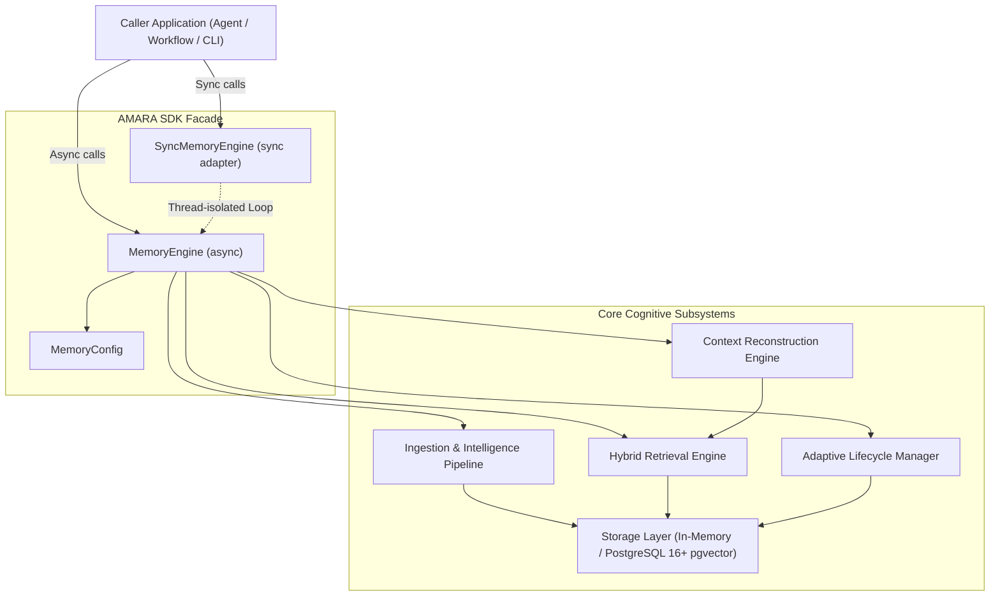

# AMARA Public Python SDK Specification

The AMARA Python SDK provides a clean, model-agnostic, developer-friendly interface to the cognitive memory framework. It is designed **asynchronous-first** for high-throughput production services while offering a thread-isolated **synchronous adapter** for scripts, notebooks, and traditional synchronous applications.

---

## 1. Architectural Overview



---

## 2. Configuration (`MemoryConfig`)

`MemoryConfig` centralizes all engine parameters, supporting explicit code configuration and automated environment variable discovery via `MemoryConfig.from_env()`.

### Configuration Parameters

| Parameter | Type | Default | Environment Variable | Description |
|---|---|---|---|---|
| `storage_backend` | `str` | `"memory"` | `AMARA_STORAGE_BACKEND` | Persistence engine: `"memory"` or `"postgres"`. |
| `database_url` | `str \| None` | `None` | `AMARA_DATABASE_URL` | Async PostgreSQL connection string (`postgresql+asyncpg://...`). |
| `db_pool_size` | `int` | `10` | `AMARA_DB_POOL_SIZE` | Maximum connection pool size for PostgreSQL. |
| `db_max_overflow` | `int` | `10` | `AMARA_DB_MAX_OVERFLOW` | Maximum overflow connections during peak loads. |
| `default_tenant_id` | `str` | `"default"` | `AMARA_DEFAULT_TENANT_ID` | Default tenant scope for multi-tenant isolation. |
| `default_namespace` | `str` | `"default"` | `AMARA_DEFAULT_NAMESPACE` | Default memory partition / namespace. |
| `decay_half_life_days` | `float` | `30.0` | `AMARA_DECAY_HALF_LIFE_DAYS` | Exponential half-life in days for recency scoring. |
| `similarity_threshold` | `float` | `0.82` | `AMARA_SIMILARITY_THRESHOLD` | Cosine similarity threshold for deduplication and consolidation. |
| `abstention_threshold` | `float` | `0.35` | `AMARA_ABSTENTION_THRESHOLD` | Minimum relevance threshold below which abstention is recommended. |
| `token_budget` | `int` | `2048` | `AMARA_TOKEN_BUDGET` | Default token capacity for prompt context reconstruction. |
| `system_reserved_tokens` | `int` | `256` | `AMARA_SYSTEM_RESERVED_TOKENS` | Tokens reserved for system headers in context reconstruction. |
| `auto_archive_expired` | `bool` | `True` | `AMARA_AUTO_ARCHIVE_EXPIRED` | Automatically transition expired records to `ARCHIVED`. |

---

## 3. Asynchronous `MemoryEngine`

### Initialization and Resource Management

`MemoryEngine` implements Python's asynchronous context manager protocol (`__aenter__` and `__aexit__`) to guarantee clean connection pool disposal and background worker termination.

```python
from amara.sdk.config import MemoryConfig
from amara.sdk.engine import MemoryEngine

config = MemoryConfig.from_env()
async with MemoryEngine(config=config) as engine:
    # Engine is initialized and ready
    item = await engine.remember("User prefers Python 3.12.")
```

### Core Methods

#### 1. `remember()`
Ingests, normalizes, extracts facts/entities, computes semantic embeddings, deduplicates, checks contradictory assertions, and persists a new memory item.

```python
item = await engine.remember(
    content="Customer account Tier is Enterprise with 99.99% SLA commitment.",
    author_id="crm_sync_agent",
    memory_type="semantic",  # working, episodic, semantic, procedural, associative
    confidence=0.95,  # 0.0 to 1.0
    importance=0.90,  # 0.0 to 1.0
    tenant_id="tenant_acme",  # Optional override
    namespace="production",  # Optional partition
    session_id="session_402",  # Optional thread link
    metadata={"contract_id": "C-981"},
    valid_from=None,  # Defaults to UTC now
    valid_to=None,  # Optional temporal expiration
    evidence=[
        {
            "source_reference": "CRM Contract #981",
            "raw_payload": "Guaranteed availability 99.99%",
            "confidence_score": 1.0,
        }
    ],
)
```

#### 2. `recall()`
Performs multi-channel hybrid search combining dense vector embeddings, lexical BM25 matching, temporal validity filters, and relational association traversal.

```python
from amara.retrieval.types import RetrievalStrategy

results = await engine.recall(
    query="customer contract SLA commitments",
    strategy=RetrievalStrategy.HYBRID,  # DENSE_VECTOR, LEXICAL_SPARSE, TEMPORAL_RECENCY, RELATIONAL_GRAPH, HYBRID
    top_k=5,
    tenant_id="tenant_acme",
    namespace="production",
    include_historical=False,
)

for match in results.results:
    print(f"[{match.relevance_score:.2f}] {match.item.content} (Confidence: {match.confidence})")
```

#### 3. `update()`
Executes an optimistic concurrency controlled modification to a memory record's content and/or metadata tags, incrementing the version counter and emitting update audit events.

```python
updated = await engine.update(
    memory_id=item.id,
    new_content="Customer account Tier is Enterprise with 99.999% High Availability SLA.",
    metadata_updates={"sla_upgraded": True},
    tenant_id="tenant_acme",
)
assert updated.version == 2
```

#### 4. `forget()`
Executes soft tombstoning (`TOMBSTONED` status) or physical purging of a memory record. Respects retention locks and cascades along derivation trees when specified.

```python
# Soft tombstone (preserves audit lineage)
success = await engine.forget(memory_id=item.id, hard=False)

# Permanent physical purge with cascade along derivation lineage
purged = await engine.forget(memory_id=item.id, hard=True, cascade=True, force=True)
```

#### 5. `archive()` & `restore()`
Transitions memory between active lifecycle state and cold, immutable storage.

```python
# Cold storage
archived = await engine.archive(memory_id=item.id)

# Return to active pool
restored = await engine.restore(memory_id=item.id)
```

#### 6. `consolidate()`
Executes episodic-to-semantic memory synthesis: clusters related episodic interactions using semantic proximity, generates compact semantic summaries, preserves historical source attribution, and records derivation relationships.

```python
consolidated_items = await engine.consolidate(
    tenant_id="tenant_acme",
    namespace="production",
)
```

#### 7. `reconstruct()`
Accepts a prompt query and performs token-bounded, citation-stamped context reconstruction with relevance filtering, redundancy removal, and abstention recommendation.

```python
context = await engine.reconstruct(
    query="What SLA does the customer have?",
    budget=500,  # Max tokens
    strategy=RetrievalStrategy.HYBRID,
)

print(context.formatted_context)
# Output includes formatted citation tags:
# [REF-1] (Semantic | Conf: 0.95 | Valid: [2026-11-13 to Present])
# Customer account Tier is Enterprise with 99.99% SLA commitment.
```

#### 8. `inspect()`
Returns the complete provenance graph of a memory item: original text, author, session, corroborating evidence items, parent derivation IDs, and relational edges.

```python
details = await engine.inspect(memory_id=item.id)
print(f"Record: {details.record.content}")
print(f"Evidence items: {len(details.evidence)}")
print(f"Graph edges: {len(details.relationships)}")
```

#### 9. `stats()`
Aggregates tenant/workspace metrics: total memories, category breakdown (`semantic`, `episodic`, etc.), lifecycle status counts, and average cognitive confidence/importance.

```python
metrics = await engine.stats(tenant_id="tenant_acme")
print(f"Total memories: {metrics.total_memories}")
print(f"Category counts: {metrics.by_category}")
print(f"Status distribution: {metrics.by_status}")
print(f"Average confidence: {metrics.average_confidence}")
```

---

## 4. Synchronous `SyncMemoryEngine`

For environments where asynchronous execution is inconvenient (e.g. legacy synchronous WSGI applications, simple scripts, or interactive REPL sessions), AMARA provides `SyncMemoryEngine`.

It spawns a background worker thread (`AMARA-SyncWorker`) with an isolated `asyncio` event loop. All SDK operations dispatch coroutines to the worker thread safely via `asyncio.run_coroutine_threadsafe`, avoiding event loop conflicts and deadlocks.

```python
from amara.sdk.config import MemoryConfig
from amara.sdk.sync import SyncMemoryEngine

config = MemoryConfig(storage_backend="memory")

# Using context manager for deterministic shutdown
with SyncMemoryEngine(config=config) as engine:
    # Synchronous ingestion
    item = engine.remember("Synchronous operation operates in dedicated thread loop.")
    
    # Synchronous recall
    response = engine.recall(query="thread loop")
    print(response.results[0].item.content)
    
    # Synchronous context prompt reconstruction
    context = engine.reconstruct(query="thread loop execution", budget=400)
    print(context.formatted_context)
```

