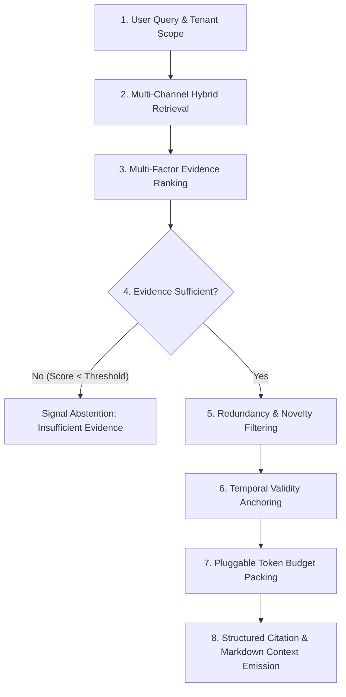

# AMARA Context Reconstruction Architecture

**Author**: AMARA Architecture & AI Research Team  
**Date**: November 2026  
**Status**: Implemented (v0.1 / Phase 6)  
**Related Documents**: [`retrieval-pipeline.md`](retrieval-pipeline.md), [`memory-lifecycle.md`](memory-lifecycle.md), [`data-model.md`](data-model.md)

---

## 1. Overview

Context Reconstruction is the synthesis engine that bridges long-term persistent memory and the generative prompt window of large language models. Rather than dumping raw semantic search chunks into a system prompt, AMARA executes a rigorous, multi-factor 8-stage reconstruction pipeline.



---

## 2. The 8-Stage Reconstruction Pipeline

### Stage 1: Query & Budget Acceptance
The caller provides:
- Query text.
- Tenant ID (enforcing strict multitenant authorization).
- Namespace (default: `default`).
- `ContextBudget`: specifies `max_tokens` (e.g. 2048), `system_reserved_tokens` (e.g. 256), and available memory budget.

### Stage 2: Multi-Channel Hybrid Retrieval
Queries are dispatched via `MemoryRetrievalEngine.retrieve(...)`, generating scored candidates from semantic embeddings, lexical tokens, temporal decay scoring, and graph associations.

### Stage 3: Multi-Factor Evidence Ranking
Retrieval relevance score is transparently combined with epistemic confidence and intrinsic importance to produce composite rank score $S_{\text{composite}}$:
$$S_{\text{composite}} = w_{\text{rel}} \cdot S_{\text{relevance}} + w_{\text{conf}} \cdot \text{confidence} + w_{\text{imp}} \cdot \text{importance}$$
*Default weights: $w_{\text{rel}} = 0.60, w_{\text{conf}} = 0.25, w_{\text{imp}} = 0.15$.*

### Stage 4: Abstention Gating
If no candidate memories match the query, or if the highest candidate relevance score is below `abstention_threshold` (default: 0.35), the engine sets:
- `abstention_recommended = True`
- `abstention_reason = "Insufficient evidence: highest retrieval relevance (0.28) is below confidence threshold (0.35)."`

This prevents LLM hallucinations on out-of-distribution queries.

### Stage 5: Redundancy & Novelty Filtering
Greedy novelty filtering evaluates prospective candidates against already selected items. If the token Jaccard similarity exceeds `redundancy_similarity_threshold` (default: 0.82), the duplicate is omitted from the prompt and logged in telemetry.

### Stage 6: Temporal Anchoring
Every candidate is bound to its bitemporal validity bounds:
- Formats: `"Asserted: 2026-11-01 12:00 UTC | Valid: [2026-11-01 to Present]"` (or explicit expiration date).
- Ensures downstream LLMs do not confuse historical beliefs with currently active state.

### Stage 7: Pluggable Token Budget Packing
Using a `TokenCounter`, candidates are packed up to `budget.available_memory_tokens`. If a candidate would push total tokens over the limit, it is skipped and counted in `candidates_omitted_budget`.

### Stage 8: Structured Citation & Context Emission
Emits:
- `formatted_context`: Clean Markdown prompt block with explicit tags (`[REF-1]`, `[REF-2]`, ...).
- `citations`: Strongly-typed list of `ContextCitation` objects linking each tag to `memory_id`, `source_id`, `author_id`, `confidence`, and snippets.

---

## 3. Pluggable Token Counting Architecture

Token counting is abstracted through the `TokenCounter` runtime protocol:

```python
class TokenCounter(Protocol):
    def count_tokens(self, text: str) -> int: ...
```

Supported Implementations:
1. `HeuristicTokenCounter` (Default):
   - Zero external dependencies.
   - Deterministic word delimiter splitting and calibrated character length heuristic ($\approx 4\text{ chars/token}$).
2. `TiktokenTokenCounter`:
   - Pluggable adapter for OpenAI's `tiktoken` BPE tokenizer (`cl100k_base`, `o200k_base`).
   - Automatically falls back to `HeuristicTokenCounter` if `tiktoken` is not installed.
3. `CallableTokenCounter`:
   - Wraps any user-supplied callable (`Callable[[str], int]`) for custom tokenizers (HuggingFace tokenizers, Anthropic tokenizers, etc.).

---

## 4. Citation Format Example

```markdown
### AMARA Verified Cognitive Memory Context

[REF-1] (Semantic | Conf: 0.98 | Asserted: 2026-11-12 14:00 UTC | Valid: [2026-11-12 to Present])
AMARA uses Python 3.12 with Pydantic v2 schemas and strict Mypy typing.

[REF-2] (Semantic | Conf: 0.95 | Asserted: 2026-11-13 09:30 UTC | Valid: [2026-11-13 to Present])
PostgreSQL 16 with pgvector is used for persistent cognitive memory storage.
```
