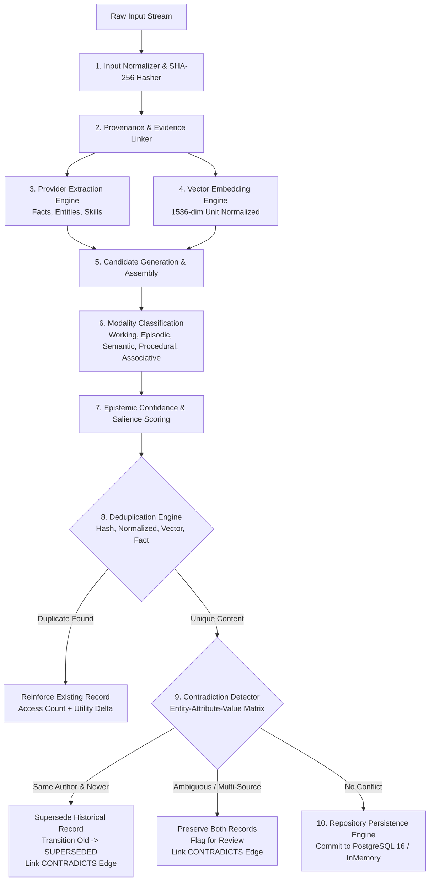

# AMARA Memory Encoding and Intelligence Engine Specification

**Document Version:** 1.0.0  
**Status:** Approved / Production-Ready  
**Phase:** Phase 4: Memory Ingestion, Feature Extraction, Deduplication, and Contradiction Handling  
**Author:** AMARA Architecture Team  

---

## 1. Executive Summary

The Memory Encoding and Intelligence Engine forms the cognitive perception and assimilation layer of the AMARA framework. It transforms raw agent inputs, user dialogues, environment observations, and tool executions into structured, scored, provenance-backed, and deduplicated `MemoryRecord` instances.

Crucially, AMARA's intelligence engine operates on a **zero-lock-in, model-agnostic provider architecture**. While capable of binding to state-of-the-art LLMs, the framework ships with high-performance, deterministic rule-based extractors and feature-hashing embedding providers that require zero external API keys, zero network connectivity, and zero paid third-party dependencies.

---

## 2. Ingestion Subsystem Architecture

The ingestion pipeline coordinates 10 deterministic stages to guarantee data integrity, tenant isolation, and cognitive coherence:

### Stage 1: Input Normalization & Integrity Hashing (`InputNormalizer`)
- **Unicode Canonical Normalization:** All inputs undergo Unicode NFKC decomposition and recomposition, harmonizing ligatures (e.g. `fi` $\to$ `fi`), accents, and full-width characters.
- **Control Character Sanitization:** Strips ANSI terminal escape sequences, carriage returns (`\r`), null bytes (`\x00`), and non-printable ASCII/Unicode control characters while strictly preserving tabs (`\t`) and intentional formatting.
- **Whitespace Regularization:** Normalizes internal line whitespace runs to single spaces, strips line boundaries, and condenses multi-line gaps into structured paragraph breaks.
- **Cryptographic Hashing:** Computes deterministic SHA-256 digests over the sanitized string, providing a permanent immutable fingerprint for tamper detection and O(1) deduplication.

### Stage 2: Source & Provenance Attribution (`ProvenanceLinker`)
- Captures immutable origin metadata: `source_id`, `source_type` (`USER_INPUT`, `SYSTEM_INSTRUCTION`, `TOOL_EXECUTION`, `ENVIRONMENT_PERCEPT`, `AGENT_REASONING`, `CONSOLIDATION_SYNTHESIS`), `author_id`, `session_id`, `source_event_id`, and `extractor_signature`.
- Creates supporting `MemoryEvidence` records storing raw excerpts and source confidence.

### Stage 3: Knowledge Extraction Subsystem
- Extracts structured propositions (`ExtractedFact`): atomic subject-predicate-object triples with polarity/negation flags.
- Extracts named entities (`ExtractedEntity`): entity name, categorical type (`PERSON`, `TECHNOLOGY`, `PREFERENCE`, `EMAIL`, `URL`, `IP_ADDRESS`, `PORT`), character spans, and confidence.
- Extracts procedural workflows (`ExtractedSkill`): numbered/bulleted action steps with ordering.

### Stage 4: Dense Vector Embedding Generation
- Produces dense 1536-dimensional unit-normalized embeddings ($\|v\|_2 = 1.0$) compatible with OpenAI-dimensioned models and pgvector indexing.

### Stage 5: Candidate Structuring (`MemoryCandidateGenerator`)
- Assembles validated `IngestionCandidate` containers holding the proposed domain `MemoryRecord`, extracted facts, entities, skills, and provenance links.

### Stage 6: Cognitive Modality Classification (`MemoryClassifier`)
Classifies inputs into AMARA's 5 core memory categories:
- **`WORKING`:** Transient goal states, scratchpads, active execution tasks (`working:`, `current task`, `todo`).
- **`EPISODIC`:** Temporally situated interactions, dialogues, observations, and system outputs (`yesterday`, `user said`, `at 14:00`, `error occurred`).
- **`SEMANTIC`:** Timeless facts, stable user preferences, policies, domain knowledge, and definitions (`prefers`, `likes`, `is a`, `standard for`).
- **`PROCEDURAL`:** Action sequences, command execution steps, runbooks, and recipes (`1. run`, `how to`, `git commit`).
- **`ASSOCIATIVE`:** Conceptual bridges and relational links (`associated with`, `linked to`, `relates to`).
> *Note on Adaptive Memory:* In strict compliance with AMARA core architecture, Adaptive memory is implemented as a continuous lifecycle management mechanism (access utility, consolidation, decay, forgetting) rather than an isolated content category.

### Stage 7: Epistemic Scoring Engine (`ScoringEngine`)
- **Epistemic Certainty (Confidence $\in [0.0, 1.0]$):** Calculated from source authority weights modulated by linguistic modality markers:
  - Source weights: `SYSTEM_INSTRUCTION` (1.0), `USER_INPUT` (0.95), `TOOL_EXECUTION` (0.90), `CONSOLIDATION` (0.85), `PERCEPT` (0.80), `REASONING` (0.75).
  - Certainty amplifiers (`definitely`, `confirmed`, `verified`): $+0.05$.
  - Hedging / Uncertainty penalties (`maybe`, `perhaps`, `guess`, `seems`): $-0.20$.
- **Intrinsic Salience (Importance $\in [0.0, 1.0]$):**
  - Modality baselines: Procedural (0.70), Semantic (0.65), Working (0.60), Associative (0.55), Episodic (0.50).
  - Salience amplifiers: Security/credentials (`password`, `api_key` $\to 0.98$), core preferences/policies ($+0.15$), greetings/chitchat ($-0.35$).

### Stage 8: Deduplication Engine (`DeduplicationEngine`)
Applies a multi-tiered duplicate detection cascade:
1. **Tier 1 (Exact Hash Match):** SHA-256 match in repository $\to$ exact duplicate ($S = 1.0$).
2. **Tier 2 (Normalized Text Match):** Equivalent sanitized text $\to$ duplicate ($S = 1.0$).
3. **Tier 3 (Semantic Triple Identity):** Identical subject-predicate-object proposition $\to$ fact match ($S = 0.98$).
4. **Tier 4 (Dense Cosine Similarity):** Vector dot product $\ge \theta$ (default $\theta = 0.95$) $\to$ semantic duplicate.

**Resolution Action:** Duplicate records are not re-inserted. Instead, `MemoryRouter` triggers reinforcement on the existing memory:
$$\text{access\_count} \leftarrow \text{access\_count} + 1$$
$$\text{utility\_score} \leftarrow \text{utility\_score} + 0.5$$
$$\text{last\_accessed\_at} \leftarrow \text{now()}$$

### Stage 9: Contradiction & Belief Revision Engine (`ContradictionDetector`)
Evaluates incoming propositions against existing active memories. Rather than silently overwriting historical data, AMARA executes a multi-dimensional comparison matrix.

### Stage 10: Memory Routing & Graph Mutation (`MemoryRouter`)
Dispatches validated candidate to persistence engine:
- If duplicate: reinforces existing record.
- If contradictory and superseding: marks old record as `SUPERSEDED`, creates new record as `ACTIVE`, and generates a bidirectional `CONTRADICTS` relationship edge.
- If contradictory and ambiguous: marks both records as `ACTIVE`, flags conflict with `review_required`, and generates a bidirectional `CONTRADICTS` relationship edge.
- If novel: commits new `ACTIVE` record to persistent storage.

---

## 3. Replaceable Provider Architecture

AMARA decouples intelligence and extraction from external vendor APIs using typed Python `Protocol` interfaces:

| Provider Protocol | Responsibilities | Default Implementation | Production Adapter |
|---|---|---|---|
| `EmbeddingProviderProtocol` | Dense text embeddings, batch embeddings, vector dimensionality. | `DeterministicRuleEmbeddingProvider` | OpenAI, Cohere, Vertex AI, HuggingFace TEI |
| `EntityExtractionProviderProtocol` | Named entity recognition, categorical typing, character offsets. | `RuleBasedEntityExtractor` | spaCy, GLiNER, LLM NER |
| `FactExtractionProviderProtocol` | Declarative proposition extraction (subject, predicate, object, polarity). | `RuleBasedFactExtractor` | LLM JSON schema extraction, REBEL |
| `LLMExtractionProviderProtocol` | Composite extraction of facts, entities, and skills in a single pass. | `RuleBasedIntelligenceProvider` | Claude, GPT-4o, Gemini 1.5, Ollama |

### 3.1 Deterministic Feature-Hashing Embeddings
The default `DeterministicRuleEmbeddingProvider` computes 1536-dimensional unit vectors using high-entropyMurmur3/SHA-256 feature hashing:
- Extracts words, word bigrams, and character trigrams.
- Hashes features into $\{0, \dots, 1535\}$ with sign bits $(-1, +1)$.
- Normalizes the resulting sparse vector using L2 norm: $\hat{v} = \frac{v}{\|v\|_2}$.
- Guarantee: Identical strings always produce identical vectors ($S_C = 1.0$), while related strings share overlapping n-gram sub-spaces.

### 3.2 Rule-Based Composite Extractor
`RuleBasedIntelligenceProvider` executes regex and heuristic grammar analyzers for:
- Entities: `TECHNOLOGY` (Python, Rust, PostgreSQL), `PERSON` (Alice, Bob), `EMAIL` (RFC 5322), `URL`, `IP_ADDRESS`, `PORT`.
- Facts: Declarative subject-predicate-object patterns with preposition peeling (e.g. separating `"dark mode in the IDE"` into core attribute `"dark mode"` and scope `"in the IDE"`).
- Skills: Ordered procedural command lists and Markdown workflow structures.

---

## 4. Multi-Dimensional Contradiction Detection Matrix

When an incoming proposition conflicts with an existing fact for a single-valued predicate (e.g. `prefers`, `runs_on`, `port`, `database`, `theme`):

| Comparison Dimension | Evaluation Rule | System Dynamic |
|---|---|---|
| **Entity & Predicate** | $\text{subject}_{\text{in}} == \text{subject}_{\text{ex}} \land \text{predicate}_{\text{in}} == \text{predicate}_{\text{ex}}$ | Anchor match |
| **Object Value** | $\text{object}_{\text{in}} \ne \text{object}_{\text{ex}} \lor \text{negated}_{\text{in}} \ne \text{negated}_{\text{ex}}$ | Value divergence identified |
| **Source Authority** | $\text{author}_{\text{in}} == \text{author}_{\text{ex}}$ | Same author revision vs multi-source conflict |
| **Temporal Ordering** | $t_{\text{in}} > t_{\text{ex}}$ where $t = \text{valid\_from} \lor \text{asserted\_at}$ | Chronological progression |
| **Validity Window** | $[v_{\text{from}}^{\text{in}}, v_{\text{to}}^{\text{in}}] \cap [v_{\text{from}}^{\text{ex}}, v_{\text{to}}^{\text{ex}}] \ne \emptyset$ | Conflicting validity overlap |
| **Confidence Delta** | $\Delta C = C_{\text{in}} - C_{\text{ex}}$ | Epistemic divergence metric |

### 4.1 Resolution Branches

1. **Temporal Evolution / Supersede (`status: "superseded"`):**
   - Condition: Same author (`author_in == author_ex`), incoming timestamp is newer ($t_{\text{in}} > t_{\text{ex}}$), and validity windows overlap.
   - Behavior: Existing record status is transitioned to `LifecycleStatus.SUPERSEDED`. Incoming record is persisted as `LifecycleStatus.ACTIVE`. A bidirectional `CONTRADICTS` edge links the two records. Historical truth is completely preserved for auditability.
2. **Concurrent / Ambiguous Conflict (`status: "review_required"`):**
   - Condition: Different authors (`author_in != author_ex`) or simultaneous assertions ($t_{\text{in}} == t_{\text{ex}}$) with conflicting values.
   - Behavior: Neither record is superseded or deleted. Both records remain active or flagged. A bidirectional `CONTRADICTS` edge links them with `resolution_rationale` describing the source divergence, exposing the conflict for user or reasoning review.
3. **Historical Divergence (`status: "unresolved"`):**
   - Condition: Incoming assertion is back-dated prior to existing knowledge ($t_{\text{in}} < t_{\text{ex}}$).
   - Behavior: Historical back-dated assertion is not allowed to overwrite newer existing knowledge. Both are retained with audit flags.

---

## 5. Security & Tenant Isolation

- **Zero Cross-Tenant Leakage:** All deduplication and contradiction queries strictly scope database operations by `tenant_id` at both application and PostgreSQL Row-Level Security (RLS) layers.
- **Fail-Safe Provider Error Handling:** When remote or primary intelligence providers encounter network timeouts, API quota exhaustions, or formatting failures:
  - If `enable_fallback_on_provider_error=True`: gracefully fails over to the local deterministic rule-based extractor.
  - If `enable_fallback_on_provider_error=False`: cleanly wraps and raises domain `ProviderError` without leaking credentials or leaving partial transactions.

