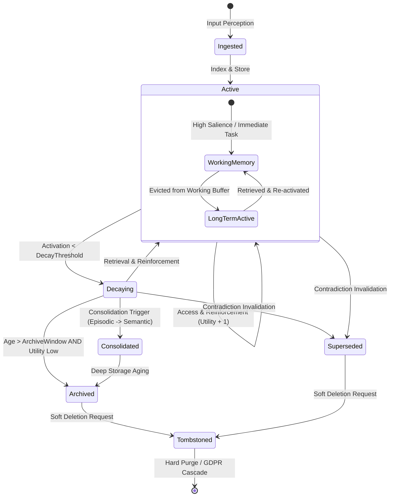

# AMARA Memory Lifecycle Specification

**Author**: AMARA Architecture & AI Research Team  
**Date**: November 2026  
**Status**: Specification Baseline (v0.1)  
**Related Documents**: [`system-design.md`](system-design.md), [`data-model.md`](data-model.md), [`security-model.md`](security-model.md)

---

## 1. Overview

In AMARA, memory is not a passive, static append-only log. It is a dynamic cognitive lifecycle state machine. A memory record transitions through progressive states of activation, reinforcement, decay, consolidation, and eventual archival or deterministic purge, mirroring the biological and cognitive dynamics of human memory.

---

## 2. Formal Memory Lifecycle State Diagram

---

## 3. Comprehensive Lifecycle Phases

### Phase 1: Ingestion & Perception
1. **Raw Event Capture**: The agent receives an input (user message, tool response, environment observation, self-generated reasoning trace).
2. **Sanitization & Security Filter**: The payload is passed through the security filter to detect API keys, sensitive credentials, and prompt injection vectors.
3. **Provenance Stamping**: The ingestion engine assigns a unique UUIDv4 `memory_id`, records `tenant_id`, `namespace`, `created_at` (UTC), `asserted_at` (UTC), and generates the cryptographic provenance metadata (source type, author signature, session ID).
4. **Modality Assignment**: Classified as Working, Episodic, Semantic, or Procedural based on payload semantics and caller intent.

### Phase 2: Indexing & Association
1. **Dense Vector Embedding**: The text payload is passed to the `EmbeddingProvider` to generate $\vec{v} \in \mathbb{R}^d$.
2. **Temporal Interval Setting**: Validity boundaries are assigned ($[t_{valid\_from}, t_{valid\_to}]$). If unbounded in the future, $t_{valid\_to} = +\infty$ (`NULL`).
3. **Entity Extraction & Association Linking**: The `ExtractionProvider` optionally identifies named entities and links the record to existing semantic concept nodes via `AssociationEdge` records.
4. **Contradiction Check**: The query engine checks whether the incoming record contradicts an existing active assertion for the same entity and predicate. If a contradiction is confirmed:
   - The existing record transitions to `SUPERSEDED`.
   - A bidirectional `ContradictionRelation` edge is established.
5. **Persistence**: The record is written transactionally to the `StorageBackend`. State is set to `ACTIVE`.

### Phase 3: Active Working Context & Retrieval Reinforcement
1. **Working Memory Inclusion**: If salience is high or marked immediate, the record enters the `WorkingMemoryManager` context buffer.
2. **Retrieval Utility Feedback**: Whenever an active memory is retrieved and incorporated into an LLM prompt that successfully achieves an agent goal:
   - `access_count` increments by 1.
   - `last_accessed_at` is updated to current UTC.
   - `utility_score` is reinforced ($U \gets U + \delta_{reward}$).
   - Base-level activation spikes, resetting its decay trajectory.

### Phase 4: Cognitive Decay & Adaptive Forgetting
1. **Continuous Activation Calculation**: The decay worker periodically computes memory base-level activation using the ACT-R power-law retention model:
   $$A(m, t) = \ln \left( \sum_{k=1}^n (t - t_k)^{-d} \right) + w_s \cdot \text{Salience}(m) + w_u \cdot \text{Utility}(m)$$
   where $t_k$ represents the historical access timestamps, $d = 0.5$ is the canonical cognitive decay rate, and $\text{Salience}(m) \in [0, 1]$.
2. **State Transition to `DECAYING`**: When $A(m, t)$ drops below the configured active threshold $\tau_{active}$, the record transitions to `DECAYING`.
   - In the `DECAYING` state, the record is excluded from high-speed working context candidate generation, but remains accessible to deep historical and temporal range queries.

### Phase 5: Consolidation & Reflection
1. **Consolidation Trigger**: The consolidation worker executes asynchronously when either:
   - A conversational session closes.
   - The count of un-consolidated episodic records in a namespace exceeds threshold $N_{consolidation}$ (e.g., 50 records).
2. **Episodic-to-Semantic Distillation**:
   - The worker clusters related episodic events using temporal and vector proximity.
   - The `ExtractionProvider` synthesizes generalized factual propositions:
     $$\text{Episodes}(e_1, e_2, \dots, e_k) \xrightarrow{\text{Distill}} \text{SemanticFact}(s_1), \dots$$
   - New `SEMANTIC` memory records are created with explicit provenance back-links (`parent_ids = [e_1.id, ..., e_k.id]`).
   - The underlying episodic records transition from `DECAYING` to `CONSOLIDATED`.

### Phase 6: Archival, Soft-Deletion, and Hard Tombstoning
1. **State Transition to `ARCHIVED`**: Memories in `CONSOLIDATED` or `DECAYING` state that have not been accessed within a retention window (e.g., 90 days) and have $\text{Utility}(m) \le 0$ transition to `ARCHIVED`.
   - Vector indexes are pruned of archived memories to keep the active HNSW index compact and high-performance.
2. **Soft Deletion (`TOMBSTONED`)**: When an agent or user issues a delete command, the record state becomes `TOMBSTONED`. It is immediately excluded from all retrieval queries.
3. **Hard Deletion / GDPR Cascade**:
   - When a hard delete or GDPR Right-to-be-Forgotten request is processed, AMARA traverses the provenance DAG.
   - It purges the target memory, removes its vector embedding, and recursively evaluates derived semantic children. If a derived semantic node has no other supporting episodic parents, it is also purged.

---

## 4. State Transition Table

| Current State | Event / Trigger | Guard Condition | Next State | Action / Side Effect |
| :--- | :--- | :--- | :--- | :--- |
| **NONE** | Perception / Ingest | Security sanitization passes | `ACTIVE` | Assign UUID, compute embedding, write to storage |
| **ACTIVE** | Goal Complete / Buffer Full | Item in working memory buffer | `ACTIVE` (Evicted) | Flush from working buffer to primary persistent store |
| **ACTIVE** | Time Elapses without Access | Activation $A(m, t) < \tau_{active}$ | `DECAYING` | Mark state `DECAYING`; exclude from default top-$k$ working search |
| **DECAYING** | Retrieval Query Match | Salience or utility high on query | `ACTIVE` | Update `last_accessed_at`, increment `utility_score`, reset activation |
| **DECAYING** | Consolidation Batch Run | Episodic cluster reaches support $\theta$ | `CONSOLIDATED` | Create derived semantic record; set parent back-pointers |
| **ACTIVE / DECAYING** | Contradiction Detected | New fact $F'$ verified to supersede $F$ | `SUPERSEDED` | Set $t_{valid\_to} = t_{now}$; create `ContradictionRelation` edge |
| **DECAYING / CONSOLIDATED** | Inactivity Threshold Reached | Elapsed time $> \tau_{archive}$, $U \le 0$ | `ARCHIVED` | Drop from active HNSW index; retain in cold storage |
| **ANY (except PURGED)** | User Delete Request | Authorized tenant caller | `TOMBSTONED` | Set `deleted_at = UTC`; drop from all standard search indexes |
| **TOMBSTONED** | GDPR Purge Window Expired | Compliance retention schedule | `PURGED` | Physical row deletion (`DELETE FROM memory_records`); cascade lineage |

