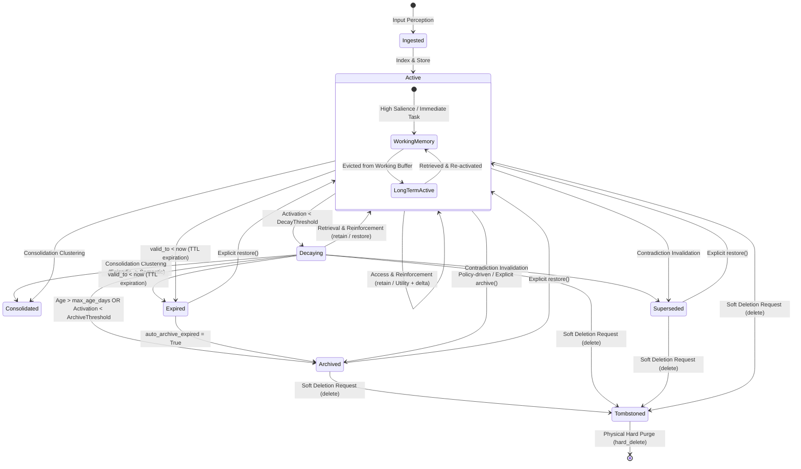

# AMARA Memory Lifecycle Specification & Implementation

**Author**: AMARA Architecture & AI Research Team  
**Date**: November 2026  
**Status**: Implemented (v0.1 / Phase 6)  
**Related Documents**: [`system-design.md`](system-design.md), [`data-model.md`](data-model.md), [`security-model.md`](security-model.md), [`context-reconstruction.md`](context-reconstruction.md)

---

## 1. Overview

In AMARA, memory is not a passive, static append-only log. It is a dynamic cognitive lifecycle state machine. A memory record transitions through progressive states of activation, reinforcement, decay, consolidation, archival, expiration, and controlled tombstoning/purge.

### Core Cognitive Invariants
1. **Epistemic Invariant**: Intrinsic importance, epistemic confidence (factual certainty), retrieval relevance, and recency are strictly decoupled concepts.
2. **Non-Recency Dominance**: Recency decays exponentially according to half-life $T_{1/2}$, but passage of time alone **never** modifies or degrades the intrinsic cognitive importance of a stored proposition.
3. **Historical Knowledge Preservation**: Archival, supersede, and consolidation transitions **never silently destroy** historical knowledge. Lineage is tracked via `root_id`, `parent_ids`, and `RelationType.DERIVED_FROM` association edges.
4. **Contradiction-Gated Consolidation**: Contradictory claims must **never** be merged into a single asserted proposition during consolidation clustering.

---

## 2. Formal Memory Lifecycle State Diagram

---

## 3. The Seven Core Lifecycle Operations

The `MemoryLifecycleManager` orchestrates seven first-class operations:

| Operation | Method Signature | Primary State Transition | Cognitive Effect |
| :--- | :--- | :--- | :--- |
| **Retain** | `retain(tenant_id, memory_id, utility_delta)` | `DECAYING -> ACTIVE` (or `ACTIVE -> ACTIVE`) | Records access count, reinforces utility score, resets decay trajectory. |
| **Update** | `update(tenant_id, memory_id, content, metadata)` | Same state (`version -> version + 1`) | Optimistic concurrency update of content or metadata without breaking root lineage. |
| **Consolidate** | `consolidate(tenant_id, namespace)` | Parents: `ACTIVE/DECAYING -> CONSOLIDATED` Child: `-> ACTIVE (SEMANTIC)` | Clusters related or near-duplicate experiences into compact semantic knowledge with `parent_ids` and `DERIVED_FROM` edges. |
| **Archive** | `archive(tenant_id, memory_id, force)` | `ACTIVE/DECAYING -> ARCHIVED` | Moves records out of active indexes into cold storage; excluded from standard retrieval unless `include_historical=True`. |
| **Restore** | `restore(tenant_id, memory_id)` | `ARCHIVED/SUPERSEDED/EXPIRED -> ACTIVE` | Re-activates historical or cold memories back into active working circulation. |
| **Expire** | `expire(tenant_id, namespace, ref_time)` | `ACTIVE/DECAYING -> EXPIRED / ARCHIVED` | Scans temporal validity windows (`valid_to < now`) and transitions expired items according to policy. |
| **Delete** | `delete(tenant_id, memory_id, hard, cascade)` | Soft: `-> TOMBSTONED` Hard: Physical deletion | Complies with GDPR Right-to-be-Forgotten, cleans up association edges, respects `retention_lock`. |

---

## 4. Multi-Attribute Policy Evaluation

The `MemoryPolicyManager` evaluates records against configurable `RetentionPolicy` rules using normalized multi-attribute scoring:

### 1. Exponential Recency Decay
Recency $R(\Delta t) \in [0.0, 1.0]$ decays exponentially from the last access or assertion anchor:
$$R(\Delta t) = 2^{-\Delta t / T_{1/2}}$$
where $T_{1/2}$ is `decay_half_life_days` (default: 30 days) and $\Delta t = t_{\text{ref}} - t_{\text{anchor}}$.

### 2. Retrieval Utility Score
Accumulated reinforcement rewards ($U \in [0.0, 1.0]$) map through a logistic sigmoid centered at zero:
$$U(\text{utility}) = \frac{1}{1 + e^{-\text{utility\_score} / 2.0}}$$

### 3. Access Frequency Score
Access count $F \in [0.0, 1.0]$ applies logarithmic diminishing returns:
$$F = \min\left(1.0, \frac{\ln(1 + \text{access\_count})}{\ln(1 + 10)}\right)$$

### 4. Composite Cognitive Activation
Activation $A(m, t) \in [0.0, 1.0]$ combines multi-attribute factors:
$$A(m, t) = \frac{w_r \cdot R + w_i \cdot \text{importance} + w_u \cdot U + w_f \cdot F}{w_r + w_i + w_u + w_f}$$

- **Critical Salience Floor**: When $\text{importance} \ge \tau_{\text{critical}}$ (e.g., 0.85), activation is clamped to at least $\tau_{\text{critical}}$, making core preferences and credentials immune to automated decay.
- **Retention Lock Override**: When `record.is_retention_locked` is True, automated decay, archival, and deletion are strictly suppressed.

---

## 5. Consolidation Subsystem

The `MemoryConsolidator` executes episodic-to-semantic knowledge synthesis:

1. **Candidate Discovery**: Clusters records within a tenant/namespace using combined lexical Jaccard overlap and dense vector cosine similarity ($S \ge \theta_{\text{sim}}$, default 0.82).
2. **Contradiction Gating**: Before clustering, pairs are evaluated by `ContradictionDetector.detect(m1, m2)`. Clusters containing mutually contradictory assertions are strictly refused from consolidation.
3. **Semantic Synthesis**: Synthesizes a compact canonical proposition from clustered parents.
4. **Provenance Preservation**:
   - Sets `memory_type = MemoryCategory.SEMANTIC`.
   - Populates `parent_ids = (p_1.id, p_2.id, ...)`.
   - Traces `root_id = p_1.root_id`.
   - Gathers all corroborating `MemoryEvidence` from all parent records.
   - Creates bidirectional or directed `RelationType.DERIVED_FROM` edges in the storage repository.
5. **Non-Destructive Transition**: Parent records transition to `LifecycleStatus.CONSOLIDATED`. They remain accessible for audit, lineage traversal, and temporal reconstruction.

---

## 6. Safe Forgetting & Retention Locks

The `ForgettingManager` provides deterministic, policy-governed forgetting:

1. **User Retention Locks**: `record.set_retention_lock(True)` stores `metadata["retention_lock"] = True`. Any automated expiration or explicit deletion without `force=True` raises `RetentionLockError`.
2. **Soft Deletion**: Default deletion transitions records to `LifecycleStatus.TOMBSTONED`. They are excluded from all vector and lexical retrieval queries.
3. **Hard Deletion / GDPR Cascade**: When `hard=True`, the record is physically deleted from storage. If `cascade=True`, the deletion cascades along orphaned derivation lineages.
4. **Audit Trail**: Every forgetting, archival, expiration, and restoration event appends an immutable `LifecycleAuditRecord` containing tenant ID, action, timestamps, previous and target status, and rationale.
